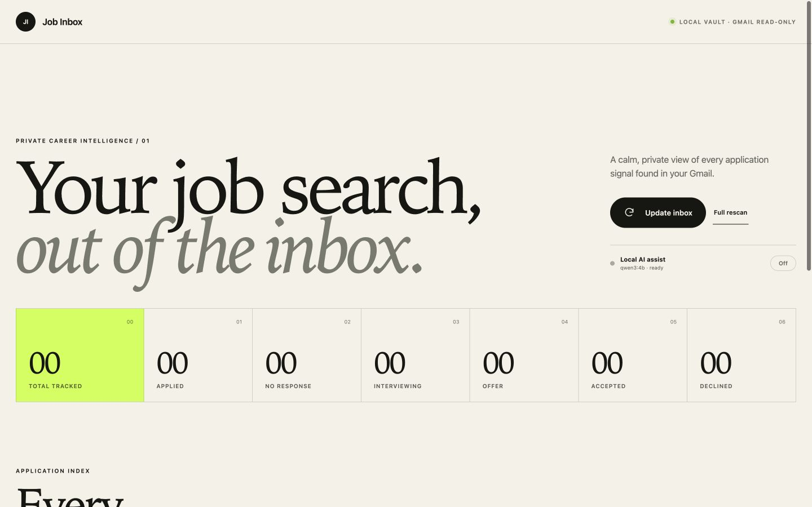
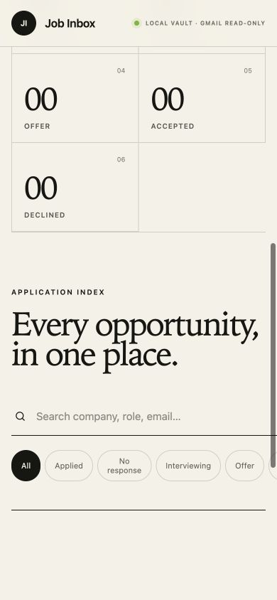

# Sift

Sift is a private, local-first job application tracker for Gmail. It separates useful application signals from inbox noise, extracts a small structured record, and presents each application in a searchable React dashboard backed by a local Go service.

The application has no hosted backend, cloud database, analytics, or third-party AI dependency. Gmail access is read-only, and the optional language model runs through Ollama on the same Mac.

## Screenshots

### Desktop



### Mobile



## Features

- Gmail OAuth using the `gmail.readonly` scope.
- Initial two-year Gmail scan, currently capped at 300 candidate messages.
- Fast incremental updates that only request email newer than the last successful scan.
- Deterministic detection of applications, interviews, employment offers, and rejections.
- Optional local-AI fallback for ambiguous wording, missing roles, and missing companies.
- Search and status filters for Applied, No response, Interviewing, Offer, Accepted, and Declined.
- Live scan-progress toast with Gmail reading and classification counts.
- Clickable application records with a direct link to the original Gmail message.
- Manual **Accepted** and **Declined** outcomes for closing an active interview.
- **Not my application** action for false positives.
- Persistent encrypted blocking of unwanted role titles.
- Message-level hiding when a role cannot be detected.
- Responsive interface with a sticky navigation bar.

## Privacy and security

- The Go API and compiled React UI bind to `127.0.0.1` only.
- Gmail access is read-only; Sift cannot send, modify, or delete email.
- Raw email bodies and OAuth access tokens are never written to disk.
- Parsing uses the sender, subject, date, and Gmail's short snippet.
- The OAuth refresh token and encryption key are held in macOS Keychain.
- Derived application records are encrypted with AES-256-GCM in:

  ```text
  ~/Library/Application Support/Job Inbox/jobs.enc
  ```

- Blocked roles and ignored Gmail message IDs are encrypted in:

  ```text
  ~/Library/Application Support/Job Inbox/blocked-roles.enc
  ```

The encrypted storage directory retains the original `Job Inbox` name for compatibility with existing local data.

- Optional AI requests are accepted only through a loopback Ollama URL. The backend rejects remote model hosts.
- There are no analytics, remote databases, hosted inference services, or external font requests.

This protects against casual file access and keeps email data away from hosted services. It cannot protect against malware or another process already operating as the logged-in macOS user.

## How classification works

Each scan follows a hybrid pipeline:

1. Gmail narrows the mailbox to likely application messages from the last two years.
2. Obvious newsletters, promotions, recommended jobs, and job alerts are rejected.
3. Deterministic rules extract the employer, role, and application status.
4. If enabled, local AI reviews only ambiguous records or stale records containing decision-like language.
5. Emails in the same Gmail thread are combined into one application record.
6. Same-company emails with a missing role are attached to the nearest detected application within 14 days, while different detected roles remain separate.
7. Blocked roles and ignored message IDs are removed before the encrypted index is saved.

## Updating the index

- **Update inbox** is the normal action. After the first successful scan, it asks Gmail only for messages newer than the previous update, with a five-minute safety overlap, then merges those events into the encrypted local index.
- **Full rescan** rebuilds the index from the two-year Gmail search. Use it after changing parsing rules or unblocking an older item.
- On a new installation, **Update inbox** automatically performs the initial full scan because no previous sync timestamp exists.

The last successful sync timestamp is encrypted locally in:

    ~/Library/Application Support/Job Inbox/sync-state.enc

### Status semantics

- **Applied** — submission confirmation or active application acknowledgement.
- **No response** — an Applied record older than 14 days with no recognized outcome.
- **Interviewing** — an actual interview invitation, screening call, assessment stage, or next round. Generic advice such as “next step” does not qualify.
- **Offer** — an employment offer made to the candidate. A job board calling a vacancy a “job offer” does not qualify.
- **Accepted** — a manually closed interview with a successful outcome.
- **Declined** — explicit rejection, unsuccessful outcome, closed/filled position, or a decision not to progress the application.

### Closing an interview

Open an **Interviewing** record and choose **Accepted** or **Declined** under **Close interview**. This only updates Sift's encrypted local record; it does not modify the Gmail message. Manual outcomes are preserved during incremental updates and full rescans.

LinkedIn Easy Apply and job-board applications can be detected when they generate a confirmation or follow-up email matching these signals. Applications that never produce an email cannot be discovered through Gmail.

## Requirements

- macOS with Keychain access.
- Go 1.22 or newer.
- Node.js 20 or newer and npm.
- A Google Cloud OAuth client.
- Optional: Ollama and the `qwen3:4b` model.

## Google OAuth setup

1. Create a project in the [Google Cloud Console](https://console.cloud.google.com/).
2. Enable the **Gmail API**.
3. Configure **Google Auth Platform**.
4. For a personal build, choose **External**, leave the app in testing, and add your Gmail address as a test user.
5. Create an OAuth client with type **Web application**.
6. Add this authorized redirect URI exactly:

   ```text
   http://127.0.0.1:8787/auth/callback
   ```

7. Copy the environment template and add the client credentials:

   ```sh
   cp .env.example .env
   ```

The OAuth client secret identifies the application. Your Gmail password is never given to Sift.

## Build and run

Clone the repository and build the application:

```sh
git clone https://github.com/Kacperkg/sift.git
cd sift
make build
./bin/job-inbox
```

Open [http://127.0.0.1:8787](http://127.0.0.1:8787).

`make build` compiles the React frontend and Go binary. `./bin/job-inbox` only starts the existing build—it does not rebuild source changes.

After changing only frontend code, this is sufficient:

```sh
cd web
npm run build
```

After changing Go code, rebuild the binary:

```sh
go build -o bin/job-inbox ./cmd/server
```

Stop a running server with `Ctrl+C` before starting a newly built binary.

## Optional local AI

Sift uses Ollama as a local fallback rather than replacing its deterministic parser. Only the sender, subject, and short Gmail snippet are supplied to the model; the full email body is not used.

Start Ollama as a macOS background service:

```sh
brew services start ollama
```

Install the default model once:

```sh
ollama pull qwen3:4b
```

Refresh Sift. The dashboard should display `qwen3:4b · ready`; use the **Local AI assist** switch to enable it for the current server session.

To enable it automatically whenever Sift starts, update `.env`:

```sh
LOCAL_AI_ENABLED=true
OLLAMA_URL=http://127.0.0.1:11434
OLLAMA_MODEL=qwen3:4b
```

Model responses use a strict JSON schema, temperature zero, a 75% confidence threshold, and server-side validation. If Ollama is unavailable or a response is invalid, the deterministic parser continues without it.

## Blocking false positives

Open an application record and use **Not my application**:

- When a role is known, **Block role** removes every exact matching role and prevents future scans from restoring it.
- When the role is unknown, **Hide email** ignores that Gmail message ID in future scans.

Blocked items appear below the application index. Select the × beside an item to allow it again. Unblocking does not immediately recreate a record; run another Gmail scan if it should be restored.

## Development

### Backend architecture

The Go backend follows a small layered structure. `cmd/server` is only the composition root; application behavior lives under `internal`:

```text
cmd/server/          process startup and dependency wiring
internal/
  apperrors/         dependency-free shared error categories
  auth/              Google OAuth and Gmail token refresh
  config/            environment loading and typed configuration
  database/          AES-GCM files and macOS Keychain access
  handlers/          HTTP request parsing and responses
  middleware/        CORS and security headers
  models/            shared application data structures
  repository/        encrypted application, block, and sync persistence
  routes/            endpoint and SPA registration
  services/          Gmail parsing, sync orchestration, and local AI
```

Dependencies flow inward: routes call handlers, handlers call services, and services use repository interfaces. Storage and HTTP details stay out of the parsing and orchestration code. This keeps the Gmail classifier testable without starting a server or opening the encrypted data store.

The React frontend uses the same separation without introducing a framework-sized architecture:

```text
web/src/
  api/                typed calls to the local Go API
  components/         reusable dashboard and detail UI
  hooks/              Sift state/actions and hash navigation
  pages/              dashboard and application-detail composition
  types/              API and domain types
  utils/              display and application helpers
  App.tsx              route-level application composition
  main.tsx             React browser entrypoint
  styles.module.css    scoped visual system with the original cascade
```

Pages compose components, hooks own browser state and actions, and the API module is the only place that knows endpoint URLs. No external state or routing dependency is needed for Sift's two local views.

For separate API and Vite development servers, set this value in `.env`:

```sh
APP_ORIGIN=http://localhost:5173
```

Start the API:

```sh
make dev-api
```

In another terminal, start Vite:

```sh
make dev-web
```

Open [http://localhost:5173](http://localhost:5173).

## Testing

Run backend tests and the production frontend build:

```sh
make test
```

The test suite includes regression cases for promotional email noise, job-board vacancy wording, false interview signals, employment offers, rejection language, duplicate merging, incremental Gmail queries, local-AI schema validation, and blocked-item filtering.

## Troubleshooting

### Local AI switch is disabled

Check the Ollama service and model:

```sh
brew services start ollama
ollama list
```

The configured model must appear as `qwen3:4b`. If it does not, run `ollama pull qwen3:4b` and refresh Sift.

### OAuth says it is not configured

Confirm `GOOGLE_CLIENT_ID` and `GOOGLE_CLIENT_SECRET` are present in `.env`, then restart Sift.

### A corrected classification is not visible

Parser changes affect records during a scan. Restart the newly built server, press **Full rescan**, and wait for the progress toast to report completion.
